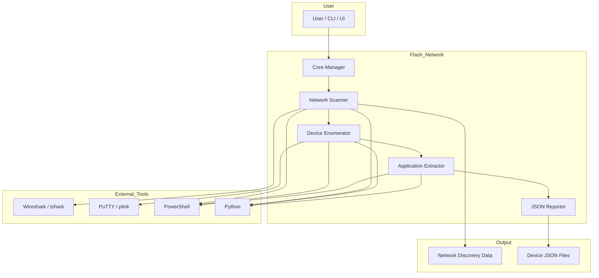
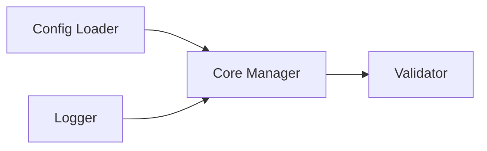
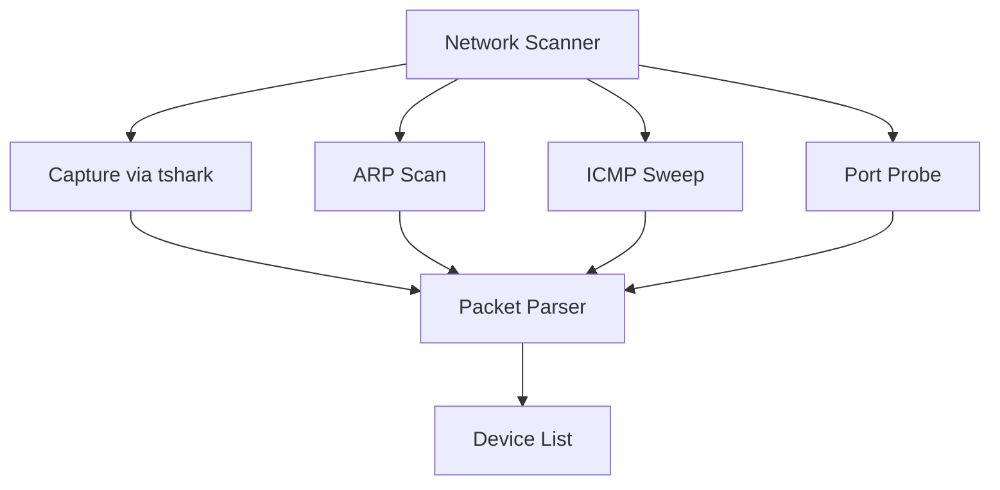
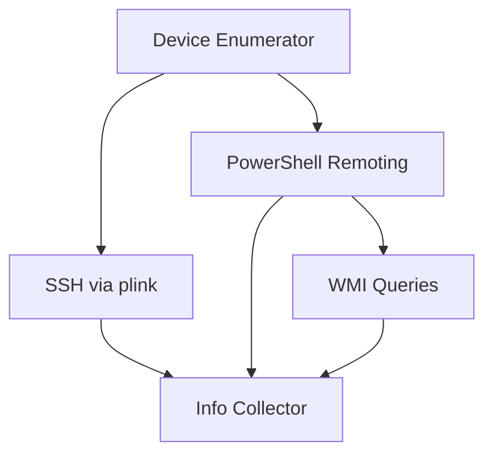
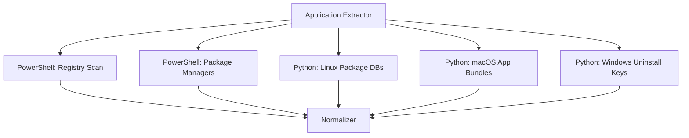
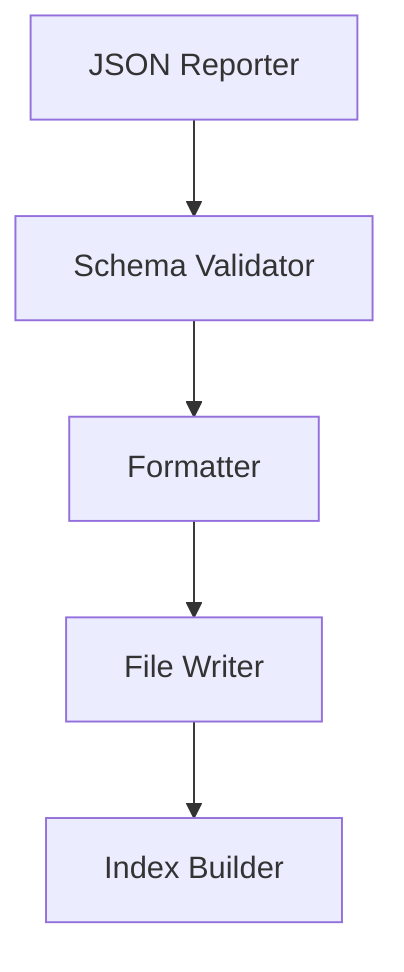
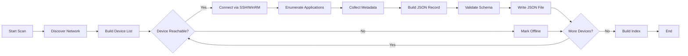
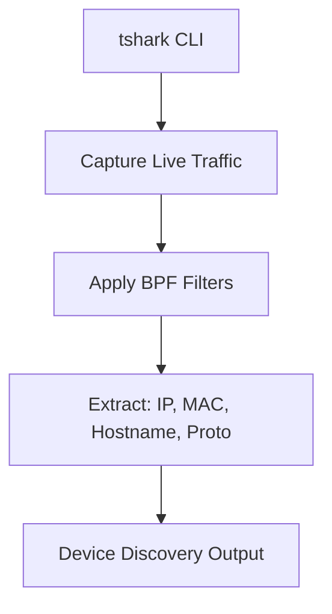
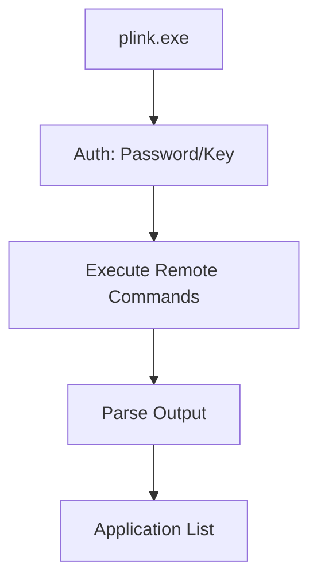
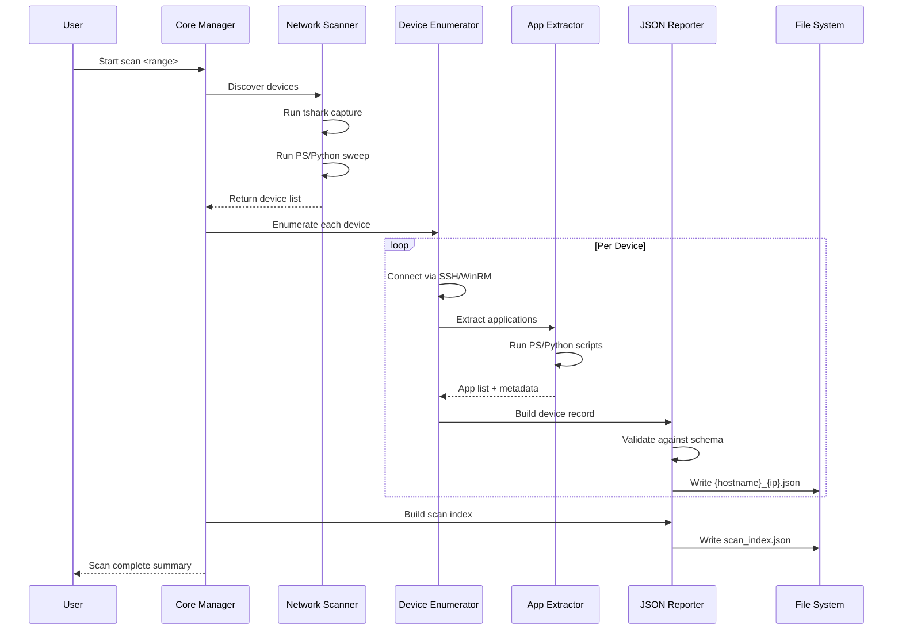

# infrastructure_scan_build — Application Outline

## Overview

Flash_Network is a network scanning and device auditing application that leverages **Wireshark**, **PuTTY**, **PowerShell**, and **Python** to discover devices on a local network, enumerate installed applications, and produce structured JSON audit files per device.  Builds a diagram showing all devices.  There is also a widget for the container homepage.

---

## High-Level Architecture



---

## Module Breakdown

### 1. Core Manager

Coordinates the entire workflow: configuration loading, module orchestration, error handling, and logging.



**Responsibilities:**
- Load `config.yaml` / `config.json` for scan parameters
- Initialize logging and output directory
- Dispatch pipeline stages sequentially or in parallel
- Handle retries, timeouts, and error reporting

---

### 2. Network Scanner

Discovers live devices on the local network using Wireshark (tshark) and native PowerShell/Python scans.



**Wireshark Integration:**
- Uses `tshark` CLI to capture traffic on local interface
- Filters for ARP, DHCP, DNS, and broadcast packets
- Extracts MAC addresses, IPs, and hostnames

**PowerShell Integration:**
- `Get-NetNeighbor` for ARP table
- `Test-Connection` for ICMP sweeps
- Custom port scanning via `Test-NetConnection`

**Python Integration:**
- `scapy` for raw packet crafting and ARP sweeps
- `socket` for TCP/UDP port probes
- `netifaces` or `psutil` for interface enumeration

---

### 3. Device Enumerator

Connects to discovered devices via PuTTY/plink (SSH) or PowerShell remoting (WinRM) to gather device-level information.



**PuTTY Integration:**
- Uses `plink.exe` for non-interactive SSH/serial connections
- Executes remote commands to gather OS info, hostname, and installed packages
- Supports credential management via config

**PowerShell Integration:**
- `Invoke-Command` for remote script execution
- WMI/CIM queries for hardware and OS inventory
- Registry queries for installed applications on Windows

---

### 4. Application Extractor

Enumerates all installed applications on each device using PowerShell and Python fallbacks.



**PowerShell Sources:**
- `HKLM:\SOFTWARE\Microsoft\Windows\CurrentVersion\Uninstall`
- `HKLM:\SOFTWARE\WOW6432Node\...\Uninstall` (32-bit on 64-bit)
- Winget: `winget list`
- Chocolatey: `choco list --local-only`
- MSI inventory via `Get-WmiObject Win32_Product`

**Python Sources:**
- Windows: `_winreg` / `winreg` module for uninstall keys
- Linux: `dpkg -l`, `rpm -qa`, `pacman -Q`, `snap list`
- macOS: `system_profiler SPApplicationsDataType`, `/Applications` scanning

---

### 5. JSON Reporter

Generates one JSON file per device with a standardized schema.



---

## JSON Output Schema

Each device gets its own file: `{hostname}_{ip_address}.json`

```json
{
  "device": {
    "hostname": "WORKSTATION-01",
    "ip_address": "192.168.1.50",
    "mac_address": "AA:BB:CC:DD:EE:FF",
    "os": "Windows 10 Pro 22H2",
    "architecture": "x64",
    "scan_timestamp": "2026-05-02T20:00:00Z",
    "scan_methods": ["tshark", "plink", "powershell", "python"]
  },
  "applications": [
    {
      "name": "Wireshark",
      "version": "4.2.5",
      "last_update": "2026-03-15",
      "signer": "Gerald Combs / Wireshark Foundation",
      "install_location": "C:\\Program Files\\Wireshark",
      "url": "",
      "publisher": "Wireshark Foundation",
      "install_date": "2026-03-15",
      "architecture": "x64",
      "source": "registry"
    },
    {
      "name": "PuTTY",
      "version": "0.81",
      "last_update": "2026-01-10",
      "signer": "Simon Tatham",
      "install_location": "C:\\Program Files\\PuTTY",
      "url": "",
      "publisher": "Simon Tatham",
      "install_date": "2026-01-10",
      "architecture": "x64",
      "source": "winget"
    }
  ],
  "scan_summary": {
    "total_applications": 47,
    "scan_duration_seconds": 32.4,
    "errors": []
  }
}
```

---

## Data Flow



---

## Directory Structure

```
Flash_Network/
├── config/
│   ├── network_ranges.yaml       # CIDR ranges to scan
│   ├── credentials.yaml          # Encrypted creds for remote access
│   └── scanner_settings.yaml     # Timeouts, retries, threads
├── modules/
│   ├── network_scanner.py        # Wireshark/ARP/ICMP discovery
│   ├── network_scanner.ps1       # PowerShell network sweep
│   ├── device_enumerator.py      # SSH/PuTTY remote connection
│   ├── device_enumerator.ps1     # PowerShell remoting
│   ├── app_extractor.py          # Python application enumeration
│   ├── app_extractor.ps1         # PowerShell application enumeration
│   └── json_reporter.py          # JSON schema + file generation
├── output/
│   └── scans/
│       └── {date}/
│           ├── {hostname}_{ip}.json   # One per device
│           └── scan_index.json        # Master index of all scans
├── logs/
│   └── flash_network.log
├── requirements.txt              # Python dependencies
├── Flash_Network.ps1             # PowerShell entry point
├── main.py                       # Python entry point
└── README.md
```

---

## Tool Integration Details

### Wireshark (tshark)



| Parameter | Value |
|---|---|
| Interface | Auto-detect or user-specified |
| Capture Duration | 10–30 seconds |
| Filters | `arp`, `bootp`, `dns`, `mdns`, `ssdp` |
| Output | Parsed device table (IP, MAC, hostname) |

### PuTTY (plink)



| Parameter | Value |
|---|---|
| Protocol | SSH-2 |
| Auth | SSH key or password |
| Commands | `dpkg -l`, `rpm -qa`, `ls /Applications`, `reg query` |
| Fallback | PowerShell remoting if SSH unavailable |

---

## Processing Pipeline



---

## Key Features

1. **Dual Engine** — Both PowerShell and Python implementations for cross-platform support
2. **Wireshark Integration** — Passive network discovery via tshark capture
3. **PuTTY Integration** — Active device probing via SSH/plink
4. **Per-Device JSON** — Standardized schema with versioning
5. **Signer Tracking** — Captures code signer/publisher for each application
6. **URL Placeholder** — Editable URL field for documentation links
7. **Scalable** — Threaded/async scanning for large networks
8. **Resume Support** — Index tracks completed devices for interrupted scans
9. **Logging** — Full audit trail in structured log files