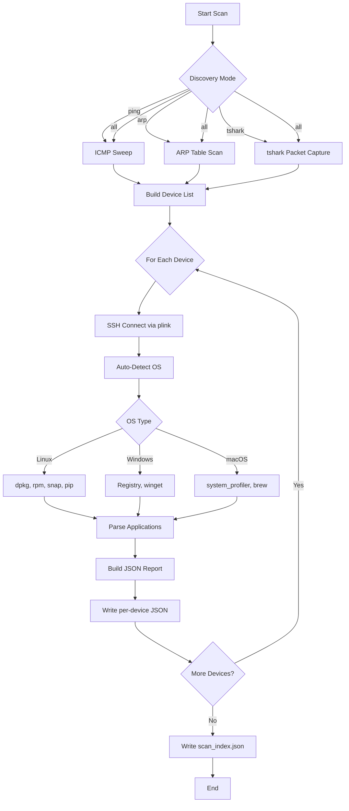

# infrastructure_scan_build — Device Scanner Extension

## Overview

The **Device Scanner** (`device_scanner.py` / `device_scanner.ps1`) is the core pipeline that ties network discovery, remote enumeration, and JSON reporting together. It discovers live devices on the network, connects via SSH using plink.exe, auto-detects the OS, enumerates installed applications, and generates a standardized JSON file per device.

---

## Pipeline



---

## Python Usage

```bash
python device_scanner.py [options]
```

| Flag | Description |
|---|---|
| `-r, --range CIDR` | Network CIDR range (e.g. `192.168.1.0/24`). Default: auto-detect |
| `-m, --mode MODE` | Discovery mode: `ping`, `arp`, `tshark`, `all` (default) |
| `-i, --interface NUM` | Interface index for tshark |
| `-n, --max-devices NUM` | Maximum devices to scan |
| `-p, --port PORT` | SSH port (default: 22) |
| `-u, --user USER` | SSH username (default: root) |
| `-k, --key FILE` | SSH private key (.ppk) |
| `-pw, --password PWD` | SSH password |
| `-o, --output DIR` | Output directory (default: `./output/`) |
| `-t, --timeout SEC` | SSH timeout (default: 30) |
| `-v, --verbose` | Verbose output |
| `-q, --quiet` | JSON-only, no console output |
| `--list-interfaces` | List tshark interfaces |
| `-h, --help` | Show help |

### Examples

```bash
# Auto-detect and scan full local network
python device_scanner.py

# Specific range with SSH key
python device_scanner.py -r 192.168.1.0/24 -k ~/.ssh/key.ppk -u admin

# Quick ping-only, max 10 devices
python device_scanner.py -m ping -n 10

# Password auth, verbose, custom output
python device_scanner.py -r 10.0.0.0/24 -u admin -pw SecretPass -v -o ./reports/
```

---

## PowerShell Usage

```powershell
.\device_scanner.ps1 [options]
```

| Parameter | Description |
|---|---|
| `-Range CIDR` | Network CIDR range (default: auto-detect) |
| `-Mode MODE` | `ping`, `arp`, `tshark`, `all` (default) |
| `-Interface NUM` | Interface index for tshark |
| `-MaxDevices NUM` | Maximum devices to scan |
| `-Port PORT` | SSH port (default: 22) |
| `-User USER` | SSH username (default: root) |
| `-Key FILE` | SSH private key (.ppk) |
| `-Password PWD` | SSH password |
| `-OutputDir DIR` | Output directory (default: `./output/`) |
| `-Timeout SEC` | SSH timeout (default: 30) |
| `-Verbose` | Verbose output |
| `-Quiet` | JSON-only output |
| `-Help` | Show help |

### Examples

```powershell
# Auto-detect and scan
.\device_scanner.ps1

# Specific range with SSH key
.\device_scanner.ps1 -Range "192.168.1.0/24" -Key "C:\keys\key.ppk" -User admin

# Ping-only, max 10 devices
.\device_scanner.ps1 -Mode ping -MaxDevices 10

# Verbose with custom output
.\device_scanner.ps1 -Range "192.168.1.0/24" -Verbose -OutputDir "./reports/"
```

---

## JSON Output Schema

### Per-Device File (`{hostname}_{ip}_{timestamp}.json`)

```json
{
  "device": {
    "hostname": "WORKSTATION-01",
    "ip_address": "192.168.1.50",
    "mac_address": "AA:BB:CC:DD:EE:FF",
    "os": "Ubuntu 22.04 LTS",
    "architecture": "x86_64",
    "scan_timestamp": "2026-05-02T20:00:00+00:00",
    "scan_methods": ["ping", "ssh", "os_detect_linux", "dpkg", "snap", "pip"]
  },
  "applications": [
    {
      "name": "python3",
      "version": "3.10.12",
      "last_update": "",
      "signer": "Ubuntu Developers",
      "install_location": "",
      "url": "",
      "publisher": "Ubuntu Developers",
      "install_date": "",
      "architecture": "",
      "source": "dpkg"
    },
    {
      "name": "Wireshark",
      "version": "4.2.5",
      "last_update": "20260315",
      "signer": "Wireshark Foundation",
      "install_location": "C:\\Program Files\\Wireshark",
      "url": "",
      "publisher": "Wireshark Foundation",
      "install_date": "20260315",
      "architecture": "x64",
      "source": "registry"
    }
  ],
  "scan_summary": {
    "total_applications": 47,
    "scan_duration_seconds": 15.3,
    "errors": []
  }
}
```

### Scan Index (`scan_index.json`)

```json
{
  "scan_timestamp": "2026-05-02T20:05:00+00:00",
  "network_range": "192.168.1.0/24",
  "mode": "all",
  "total_devices_discovered": 12,
  "total_devices_scanned": 10,
  "total_applications_found": 432,
  "total_duration_seconds": 187.5,
  "devices": [
    {
      "ip": "192.168.1.50",
      "hostname": "WORKSTATION-01",
      "status": "success",
      "file": "./output/WORKSTATION-01_192_168_1_50_20260502_200100.json",
      "apps": 47,
      "duration": 15.3
    },
    {
      "ip": "192.168.1.99",
      "hostname": "192.168.1.99",
      "status": "error",
      "error": "Connection refused"
    }
  ]
}
```

---

## Application Sources by OS

| OS | Sources |
|---|---|
| **Linux** | `dpkg-query`, `rpm -qa`, `snap list`, `pip3 list` |
| **Windows** | Registry Uninstall keys (32/64-bit), `winget list`, `choco list` |
| **macOS** | `system_profiler SPApplicationsDataType`, `brew list --versions`, `/Applications` |

---

## Features

1. **Multi-mode discovery** — Ping sweep, ARP table, tshark passive capture, or all combined
2. **Auto OS detection** — Probes remote device and selects appropriate command suite
3. **Dual implementation** — Python and PowerShell parity
4. **Standardized JSON** — Consistent schema across all OS types
5. **Master index** — `scan_index.json` tracks all devices, successes, failures, and file paths
6. **Deduplication** — Removes duplicate app entries across sources
7. **Verbose/Quiet modes** — Full logging or JSON-only output for automation
8. **Configurable limits** — Max device count, SSH timeout, custom ports

---

## Output Structure

```
output/
├── scan_index.json
├── WORKSTATION-01_192_168_1_50_20260502_200100.json
├── SERVER-DB_192_168_1_10_20260502_200115.json
└── LAPTOP-USER_192_168_1_75_20260502_200130.json
```
